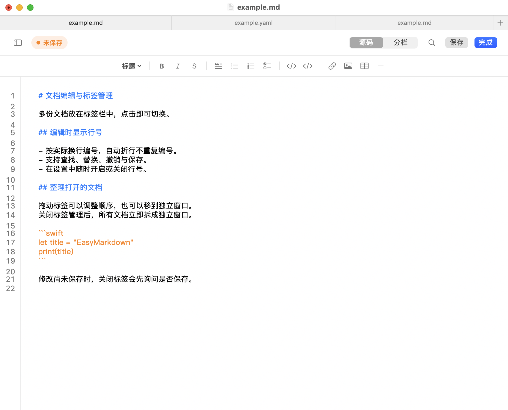
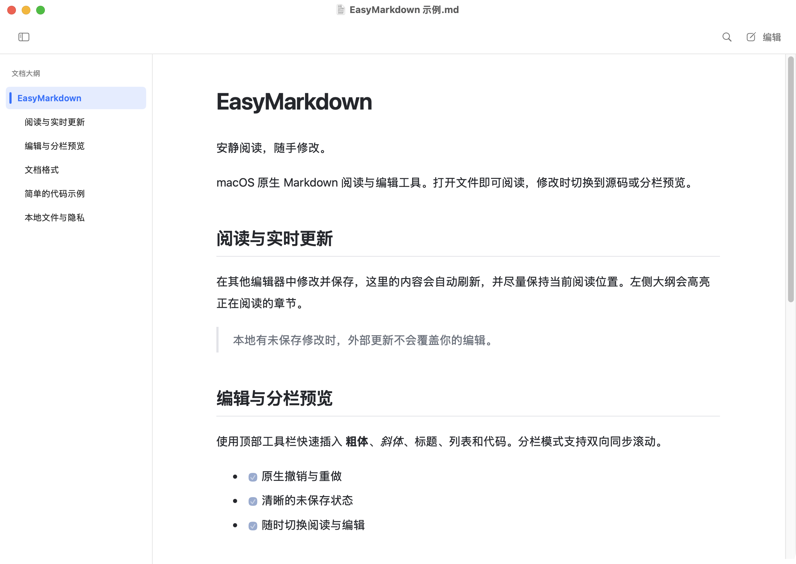
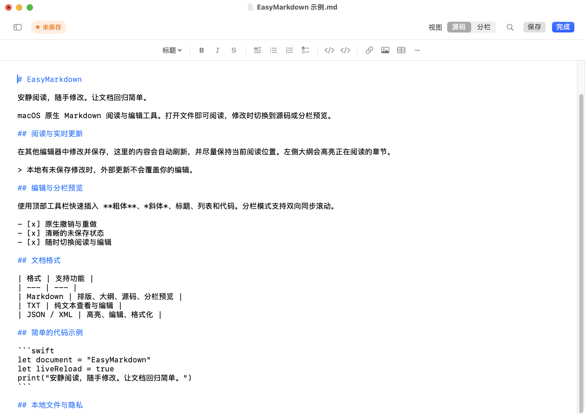
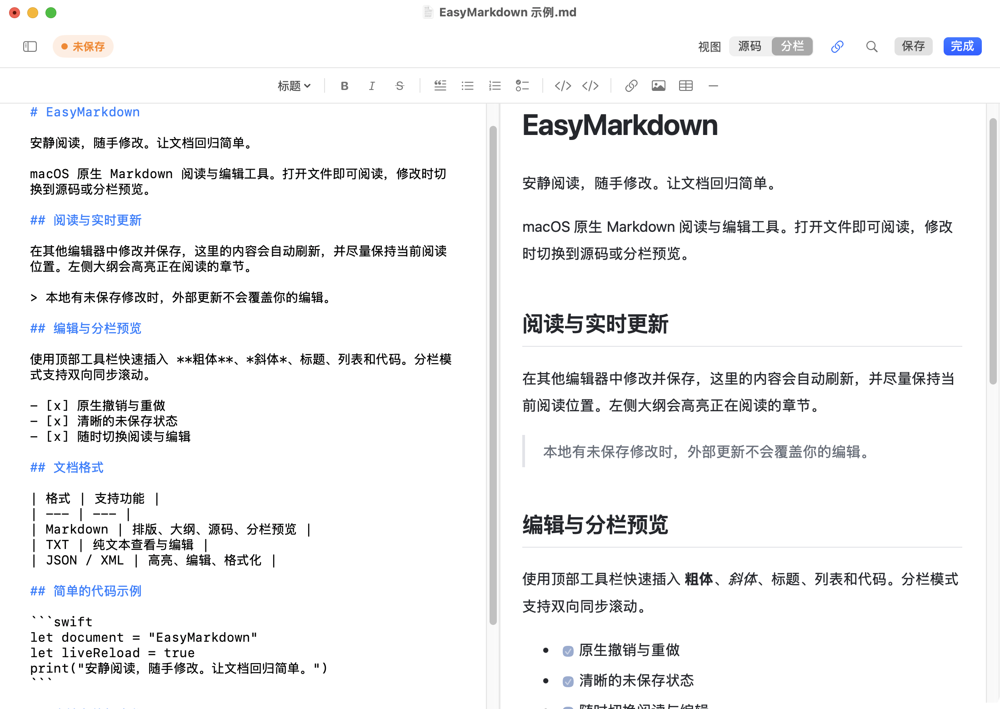
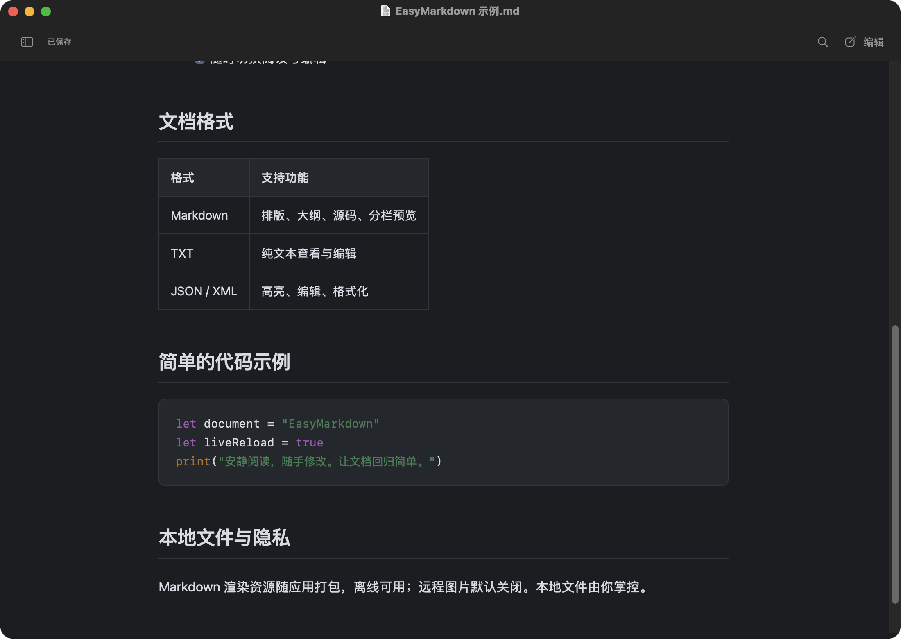

# EasyMarkdown

一款 macOS 原生的轻量文档阅读与编辑工具。以 Markdown 阅读为主，需要时随手修改，让文档回归简单。

## 功能介绍

- **专注阅读**：支持标题、表格、任务列表、引用、图片和代码高亮，可调整字号与阅读宽度。
- **章节导航**：左侧大纲高亮当前阅读章节，支持点击跳转和滚动跟随。
- **随手编辑**：阅读时输入文字可确认切换到编辑；支持源码编辑、查找替换、原生撤销重做，以及标题、列表、代码、链接等快捷语法工具栏。
- **编辑行号**：源码和分栏编辑可显示行号，自动折行保持原行编号，可在设置中开关。
- **文档标签**：通过系统原生标签切换、关闭和排列多份文档；设置中可即时切换标签管理与独立窗口。
- **实时预览**：源码与排版并排显示，支持双向同步滚动，也可独立查看。
- **确认更新**：其他编辑器保存同一文件后提示是否更新，确认后加载最新内容，尽量保持阅读位置。
- **保护修改**：醒目的未保存状态、恢复草稿和外部修改冲突提示，避免静默覆盖本地编辑。
- **多种格式**：支持 TXT，以及 YAML、TOML、INI、CONF/CFG、ENV、Properties、JSONC 等配置文件的原文查看、基础高亮和编辑；JSON、XML 还支持格式化。可在设置中查看各类型的默认状态、添加自定义后缀，按类型或一键全部设为默认编辑器。
- **原生体验**：拖入文件、多文档窗口、最近使用记录，以及浅色、深色和跟随系统外观。
- **应用内升级**：菜单和设置均可检查更新，默认每天检查一次；确认后下载、安装并重新启动，退出前保留未保存文档提醒。
- **离线可用**：Markdown 渲染资源随应用打包，远程图片默认关闭。

## 开发语言与技术栈

| 语言或技术 | 版本说明 | 用途 |
| --- | --- | --- |
| `macOS` | 最低支持 `14.0` | 原生桌面应用运行平台 |
| `Swift` | 当前本机编译器为 `6.4`；包清单要求工具链 `5.9` 及以上 | 应用主体、文档管理与核心逻辑 |
| `SwiftUI` | 由 `macOS 14` 及以上系统提供 | 窗口、设置与界面布局 |
| `AppKit`、`TextKit` | 由 `macOS 14` 及以上系统提供 | 原生文本编辑、查找替换、撤销重做与文本排版 |
| `WebKit`（`WKWebView`） | 由 `macOS 14` 及以上系统提供 | 文档阅读与实时预览 |
| `JavaScript`、`HTML`、`CSS` | 使用系统 `WebKit` 支持的语言和网页标准 | 预览交互、文档结构与阅读样式 |
| `marked` | `15.0.12` | 解析文档标记并生成预览内容 |
| `DOMPurify` | `3.3.0` | 过滤预览内容中的不安全网页元素与属性 |
| `highlight.js` | `11.11.1` | 代码语法高亮 |
| `Sparkle` | `2.10.1` | 应用更新检查、下载与安装 |

系统框架随操作系统更新，项目不单独锁定其版本。第三方组件版本以包依赖锁定记录和应用内置资源为准，预览所需脚本与样式均随应用打包，可离线使用。

## 界面预览

以下为实际应用窗口截图，使用专门的示例文档。

### 编辑行号与文档标签

左侧行号按实际换行编号，顶部原生标签管理多份文档。两个功能默认开启，也可在设置中分别关闭；关闭标签管理后，文档立即拆成独立窗口。

### 专注阅读与章节导航

Markdown 排版保持合适的阅读宽度，左侧大纲高亮当前章节。其他编辑器保存同一文件后，应用会提示是否更新；点击“确定”加载最新内容，点击“否”保留当前内容。

### 随手编辑，保存状态清晰可见

居中的语法工具栏提供标题、引用、列表、代码、链接、图片和表格等入口；橙色“未保存”标记提醒当前修改尚未写入文件，可以直接保存并继续编辑。

### 源码与预览并排，滚动同步

左侧修改源码，右侧实时预览。顶部链条按钮控制双向同步滚动，需要分别查看时也可以关闭。

### 深色阅读

支持跟随系统、浅色和深色外观，表格与代码块配色随外观调整。

